# RFC — Banco de contas conjuntas \<Banco Tera>

Oct 2, 2026 · @Adrielle

**Proposta:** um banco só de contas conjuntas para despesas compartilhadas, com titulares que entram por convite, transferência com tarifa por faixa e extrato como livro de registros.

| Campo | Valor |
| --- | --- |
| Time | Adrielle Gabriel · Guilherme Terencio |
| Data | 02/10/2026 |
| Versão | 3 |
| Revisão | 12/10/2026: a resposta da transferência usa `transfer_key`; nome, CPF e nascimento são copiados no aceite; a transferência trava três saldos (origem, destino e receitas) |

## O problema

Grupos que dividem despesas (repúblicas, casais, famílias, amigos que viajam juntos) não têm onde guardar o dinheiro comum. Hoje, uma pessoa paga o aluguel ou a conta de luz da própria conta e depois cobra as outras. O dinheiro fica espalhado em várias contas, ninguém sabe ao certo quem já pagou a sua parte, e a cobrança entre amigos gera atrito.

O problema não é só de organização. Um caso real do time: num apartamento com aluguel de R$ 5.000, todo o dinheiro dos moradores passava pela conta de uma das moradoras, que pagava o proprietário. Para a Receita Federal, os valores que ela recebia dos colegas pareciam renda dela, e ela acabou tendo que declarar e pagar imposto de renda sobre um dinheiro que nunca foi seu.

As contas conjuntas dos bancos tradicionais não resolvem: costumam ser pensadas para casais, com poucos titulares, e o extrato não mostra quem colocou e quem tirou cada valor.

Para se organizar, os grupos recorrem ao Splitwise ou a planilhas. As duas soluções só anotam quem deve quanto a quem: o dinheiro continua passando pela conta de alguém, e a anotação depende de uma pessoa atualizar cada pagamento à mão. A planilha fica desatualizada, ninguém quer ser o responsável por mantê-la, e nada garante que ela bate com o que realmente saiu das contas.

## A solução: o banco

Um banco só de contas conjuntas, feito para despesas compartilhadas:

- Cada conta tem de 2 a 6 titulares, e cada pessoa participa de uma conta só.
- Quem abre a conta é o master, que convida os outros por e-mail ou celular; o convidado não precisa ser cliente para ser convidado.
- Qualquer titular deposita e transfere sozinho, e o extrato mostra quem fez cada operação.
- Só o dinheiro que sai paga tarifa; depositar a sua parte é sempre de graça.
- Menores a partir de 15 anos participam com um adulto responsável na conta, e o master pode limitar quanto eles transferem por mês.
- O master pode bloquear a conta e definir um limite por transferência.

A tarifa da transferência é `base da faixa + máx(0, adultos ativos − 2) × R$ 0,50`. Bases: R$ 10,00 a 99,99 → R$ 0,50; R$ 100,00 a 299,99 → R$ 2,00; R$ 300,00 a 999,99 → R$ 5,00; R$ 1.000,00 a 4.999,99 → R$ 9,00; a partir de R$ 5.000,00 → R$ 12,00. Cada adulto a mais é uma notificação a mais por movimentação, por isso o grupo maior paga um pouco mais; dividida entre todos, a tarifa por pessoa fica baixa. Menores não aumentam a tarifa. O teto é R$ 14,00, abaixo da TED eletrônica dos grandes bancos.

Dois princípios guiam as regras: na dúvida sobre permitir, o sistema permite (quem decide os limites é o master); quando isso conflita com a segurança do dinheiro, a segurança vence.

**Entregue agora:** cadastro de cliente, abertura de conta com convites, depósito, transferência com tarifa, limites, bloqueio e extrato paginado. **Desenhado como próximo passo:** boleto, estorno, divisão de despesas, empréstimo, encerramento e saída de titulares.

## A jornada do cliente: hoje e com o banco

Um exemplo real: quatro pessoas dividem um apartamento, com aluguel de R$ 2.000 e contas de consumo.

| Etapa | Hoje | Com o banco |
| --- | --- | --- |
| Juntar o dinheiro do aluguel | Cada um faz um Pix para a pessoa que paga. O dinheiro se mistura com o salário dela | Cada morador deposita a sua parte na conta do apartamento, de graça. O dinheiro do grupo fica separado do dinheiro de cada um |
| Pagar o aluguel | Uma pessoa paga da própria conta e torce para todos terem mandado | Qualquer titular transfere da conta do grupo, com uma tarifa de R$ 10,00 (R$ 2,50 por pessoa) |
| Saber quem já pagou | Uma planilha ou o Splitwise, atualizados à mão por alguém do grupo, e prints de comprovante para conferir | O extrato mostra cada depósito com o nome de quem depositou |
| Explicar um gasto | "Quem pagou a internet?" vira discussão | Cada saída registra o titular que a fez, e nada some do histórico |
| Entrar um morador novo | Refazer as contas de cabeça e avisar todo mundo | O master convida por e-mail ou celular; quem ainda não é cliente vê o convite ao se cadastrar |
| Um filho ou neto morando junto | O menor depende de alguém repassar dinheiro | O menor entra na conta com um responsável confirmado, e o master define quanto ele pode transferir por mês |
| Alguém tentar fraudar o grupo | Não há controle | Cada titular passa por análise de documentos antes de entrar, e a guarda de menores é comprovada |

**Um ganho a mais: o dinheiro do grupo deixa de se misturar com a renda de cada um.** Com a conta conjunta, ninguém recebe na própria conta o dinheiro dos outros para repassar. Cada depósito fica registrado no extrato com o nome de quem depositou, e esse registro mostra de onde veio e para onde foi cada real, o que ajuda cada morador a comprovar que o valor do aluguel não era renda pessoal.

## Problemas que o banco evita e como resolvemos

| Problema | O que daria errado | Como resolvemos |
| --- | --- | --- |
| **Criar ou sumir dinheiro** | Uma transferência debita a origem e cai antes de creditar o destino; um depósito credita a conta sem que nada saia de lugar nenhum | Ledger de partidas dobradas: toda operação grava lançamentos que somam zero, numa única transação. O depósito debita a conta de liquidação da instituição (o dinheiro que veio de fora) e credita a conta do grupo; a transferência debita valor e tarifa da origem e credita o destino e a conta de receitas. Um teste confere que a soma de todos os lançamentos é sempre zero |
| **Duas operações ao mesmo tempo na mesma conta** | Dois titulares transferem juntos, os dois leem saldo de R$ 100 e gastam R$ 160 | Uma operação de cada vez por conta: o saldo é travado com `SELECT … FOR UPDATE` antes de ser conferido. A segunda operação espera a primeira terminar, lê o saldo novo e recebe 422 se não couber. Um `CHECK` no banco impede saldo negativo de cliente como última defesa |
| **Duas transferências cruzadas travando uma à outra** | A→B e B→A ao mesmo tempo: cada uma trava uma conta e espera a outra para sempre (deadlock) | As contas são travadas sempre na mesma ordem, do menor `id` para o maior |
| **Débito duplicado quando o app repete o pedido** | A rede cai antes da resposta, o app tenta de novo e o aluguel é pago duas vezes | Toda criação leva uma chave no cabeçalho `Idempotency-Key`, guardada com a resposta original em `idempotency_records` e única por escopo. A repetição devolve a mesma resposta, sem gravar de novo, mesmo se as duas chegarem juntas. O app só repete quando não recebe resposta ou recebe 5xx |
| **A mesma pessoa em dois grupos, ou um grupo com mais de 6** | Dois grupos convidam a mesma pessoa ao mesmo tempo; dois convites disputam a sexta vaga | Índices únicos parciais por pessoa, por e-mail e por celular: o banco recusa o segundo convite ou o segundo aceite. O limite de 6 é conferido com a linha da conta travada |
| **Cadastro com documento falso ou dados de outra pessoa** | Alguém abre conta com o CPF de terceiro e entra num grupo | O CPF passa pelo birô, e os documentos passam por uma esteira de análise com status e pendências. Só cliente `APPROVED` aceita convite ou abre conta |
| **Menor com um falso responsável** | Um adulto qualquer se declara responsável por uma criança | A guarda é uma relação própria, com grau de parentesco e documentos confirmados: pais comprovam com a certidão de nascimento; avós e outros responsáveis, com o documento de guarda. O menor só fica ativo com a guarda aprovada |
| **Tarifa calculada errada** | Um convidado aceita no meio da transferência e muda o número de adultos | A tarifa usa os adultos lidos no início da operação e fica gravada na transferência, junto com quantos adultos foram contados; o extrato nunca recalcula |
| **Menor gastando além do combinado** | Duas transferências do menor ao mesmo tempo passam juntas do limite | O limite mensal soma valor e tarifa das transferências do menor no mês e é conferido com o saldo travado, então uma espera a outra |
| **Descobrir quem é titular de uma conta** | Alguém testa números de conta e CPFs até achar uma combinação | "Conta inexistente" e "CPF não confere" têm exatamente a mesma resposta (404). O dígito verificador do número pega erros de digitação sem consultar o banco |
| **Ver ou mexer na conta de outra pessoa** | Trocar a chave da conta na URL e ler o extrato de outro grupo | Quem pede precisa ser titular ativo; senão, a resposta é o mesmo 404 de uma conta inexistente (R8). Nenhum `id` do banco sai na API: só chaves UUID e números de conta aleatórios (R5) |
| **Centavos errados** | Float arredonda e perde centavos a cada operação | Dinheiro é sempre centavos em inteiro, e a tarifa é um valor fixo por faixa, sem percentual (R6) |
| **Perder o histórico** | Apagar ou alterar uma operação e não conseguir mais explicar o saldo | Lançamentos e eventos só recebem `INSERT`: nada é apagado, e correções entram como registros novos (R4). Cada mudança de estado grava um evento com o motivo e o payload da mudança |
| **Um serviço cair no meio da operação** | O account-service não responde durante uma transferência | Os dados de conta são lidos antes de qualquer trava. Se o serviço não responde, a resposta é 503 e nada foi gravado; o app repete com a mesma chave, sem risco de débito duplo |
| **Dados diferentes entre os serviços** | Uma cópia de dado num serviço fica desatualizada em relação ao original | Todo dado de dinheiro mora num banco só, o do transaction-service. Os outros serviços só copiam dados que nunca mudam depois do cadastro: nome, CPF e data de nascimento |

## Como o sistema é montado

O sistema é dividido em quatro microserviços, cada um com o próprio banco de dados: **customer-service** (cadastro e birô), **account-service** (contas, convites, titulares, bloqueio e limites), **transaction-service** (depósito, transferência, tarifa, saldo e a conta da instituição) e **statement-service** (extrato, sem banco: monta a resposta a partir dos outros). Cada serviço segue as camadas do base-service, tem o próprio container no `docker compose` e só fala com os outros por HTTP, em rotas internas protegidas pelo `INTERNAL-TOKEN`. Não existe chave estrangeira entre serviços: um serviço guarda a chave pública do dado do outro. O Mockserver, também no compose, simula o birô de crédito.

A regra que torna a separação segura: **todo dado de dinheiro mora em um único banco, o do transaction-service.** Saldo, lançamentos, transferências, chaves de idempotência e tarifas ficam juntos, então as garantias de dinheiro dependem de uma única transação local. O que vem de outros serviços (estado da conta, titulares, limites) é lido por HTTP no início da operação, antes de qualquer trava. O saldo de cada conta é a soma dos lançamentos, guardada numa tabela de saldo para a checagem ser rápida e atualizada no mesmo commit. O extrato é uma consulta sobre os lançamentos, nunca uma tabela própria.

## Como os serviços conversam

Os serviços só se falam por HTTP, sempre com o `INTERNAL-TOKEN`. Os três diagramas mostram as operações em que mais de um serviço participa.

**Cadastro e análise do cliente**

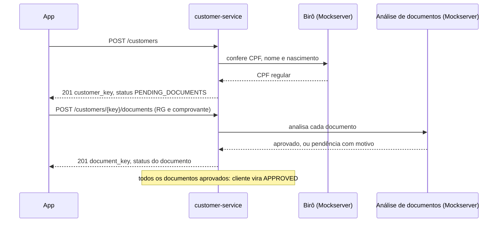

**Abertura de conta e aceite de convite**

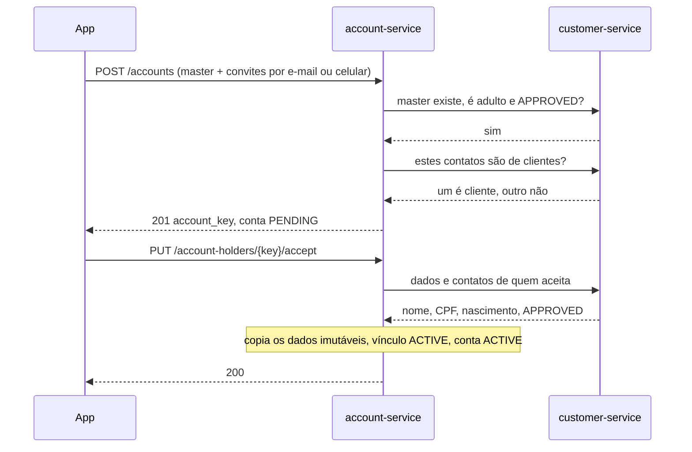

**Transferência**

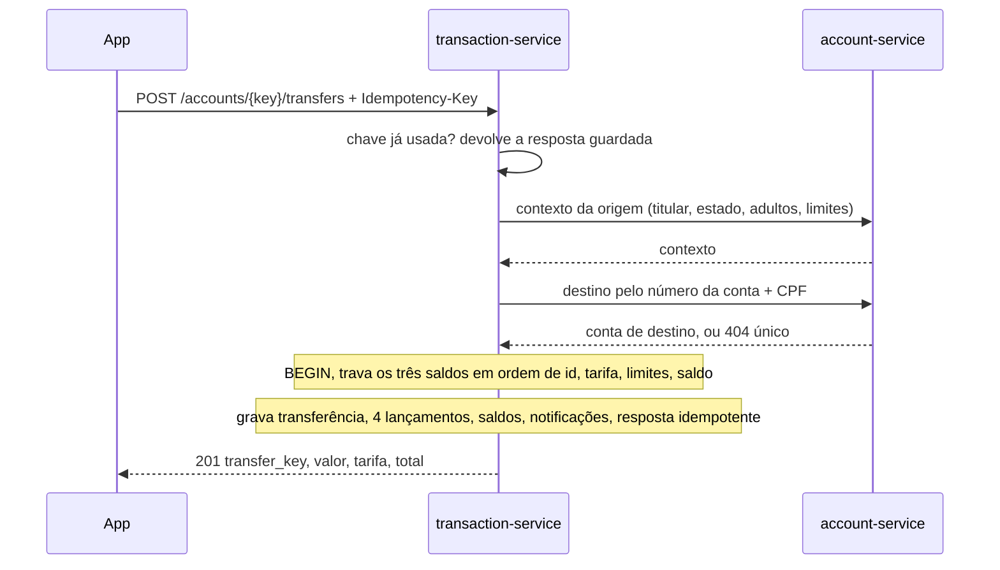

O statement-service segue o mesmo desenho: pergunta ao account-service se quem pede é titular ativo e pede os lançamentos ao transaction-service (composição de API), sem banco próprio.

## Padrões de projeto e de banco de dados

| Padrão | Onde está aplicado | Por que foi escolhido |
| --- | --- | --- |
| Arquitetura em camadas | Todos os serviços: resource → controller → repository → model, com schema na entrada e DTO na saída | Cada camada decide uma coisa só: o resource fala HTTP, o controller aplica a regra e dá o commit, o repository é a única porta do banco |
| Repository | `repositories/` de cada serviço | Toda consulta fica num lugar só; trocar o banco muda só esse arquivo |
| DTO | `dtos/` de cada serviço | Escolhe o que sai na resposta; `id` interno e dados sensíveis nunca saem |
| Banco por serviço | Um PostgreSQL por serviço, sem chave estrangeira entre bancos | Cada serviço evolui o próprio esquema sem quebrar os outros |
| Composição de API | statement-service | O extrato junta dados de dois serviços sem precisar de banco próprio nem de cópia |
| Chave de idempotência | `idempotency_records` em customer, account e transaction | Repetir uma criação devolve a mesma resposta e nunca grava duas vezes |
| Trava pessimista ordenada | `SELECT … FOR UPDATE` nos saldos e na conta, sempre em ordem de `id` | Uma operação por conta de cada vez, sem deadlock |
| Ledger de partidas dobradas | `ledger_entries` e as contas de liquidação e de receitas | Toda operação soma zero: dinheiro não é criado nem perdido |
| Registro somente de inclusão | `ledger_entries` e todas as tabelas `*_events` | Nada é apagado ou alterado (R4); o histórico explica qualquer estado |
| Máquina de estados | Tabelas `*_statuses` com as transições conferidas no controller | Os estados possíveis moram no banco; as transições permitidas, na regra |
| Tabelas auxiliares de domínio | `*_statuses`, `holder_roles`, `kinship_degrees`, `document_types`, `entry_types` | Um valor novo (um papel, um tipo de documento) é uma linha nova, sem mudar código nem esquema |
| Chave interna + chave pública | `id` serial dentro do banco; `*_key` UUID na API | O banco relaciona por inteiro, rápido; ninguém adivinha a chave de outro registro (R5) |
| Índice único parcial | `account_holders` por pessoa, e-mail e celular | Uma conta por pessoa, mantendo o histórico de quem saiu |
| Cópia de dado imutável | Nome, CPF e nascimento em `account_holders` | Evita uma chamada entre serviços sem risco de dado desatualizado |
| Tempo limite e falha explícita | Toda chamada entre serviços e ao Mockserver | Um serviço lento não prende os outros; a falha vira 502 ou 503, e o app pode repetir |

## Implementação

### Regras de negócio

Estas são as regras que o sistema aplica; cada uma que barra algo aparece como erro na tabela de rotas e como teste.

#### Estados da conta

| Estado | Quando a conta chega aqui | Envia dinheiro | Recebe dinheiro |
| --- | --- | --- | --- |
| `PENDING` | Criada pelo master, aguardando o primeiro aceite | Não | Não |
| `ACTIVE` | Primeiro convidado aceitou, ou o master desbloqueou | Sim | Sim |
| `BLOCKED` | O master bloqueou, com justificativa | Não | Sim |
| `CANCELED` | Nenhum convite pendente sobrou, ou o master cancelou a conta pendente | Não | Não |
| `CLOSING` | Encerramento aprovado por todos (próximo passo) | Só para zerar o saldo | Sim |
| `CLOSED` | Encerramento concluído com saldo zero (próximo passo) | Não | Não |

Transições: `PENDING` → `ACTIVE` ou `CANCELED`; `ACTIVE` ⇄ `BLOCKED`; `ACTIVE` → `CLOSING` → `CLOSED`. Cada mudança grava um evento com quem fez e a justificativa (R4).

#### Titulares e convites

- Toda conta é conjunta, com 2 a 6 titulares, e cada pessoa participa de uma conta só.
- O master é quem abre a conta: precisa ter 18 anos ou mais e não pode sair. Só ele convida, cancela convites, cancela a conta pendente, bloqueia, desbloqueia e define limites.
- O convidado é indicado por e-mail ou por celular e **não precisa ser cliente**. Se o contato já pertence a um cliente, o convite fica ligado a ele e ocupa a vaga dele. Se não pertence, o convite guarda o contato, e cada e-mail ou celular só pode ter um convite pendente.
- Quem não é cliente vê o convite quando se cadastra com aquele e-mail ou celular e abre o app: a lista de convites procura pela pessoa e pelos contatos dela. Nada é enviado para fora do app; o master avisa a pessoa por conta própria. O convite vale para o contato informado: se a pessoa trocar de contato antes de aceitar, o master convida de novo.
- O convite não tem prazo e conta no limite de 6. O convidado aceita, recusa ou ignora; para aceitar, precisa estar cadastrado. O primeiro aceite ativa a conta; os outros podem aceitar depois.
- No aceite, o sistema confirma que a pessoa não está em outra conta, copia nome, CPF e data de nascimento para o vínculo e cancela os outros convites pendentes dela.
- Recusar ou cancelar o último convite de uma conta ainda pendente cancela a conta, e o master fica livre para abrir outra.
- A conta é solidária: qualquer titular ativo movimenta sozinho, e cada operação registra quem a fez.

#### Menores de idade

- O cadastro aceita a partir de 15 anos; a idade é sempre calculada pela data de nascimento, nunca guardada.
- O menor só fica ativo numa conta com uma guarda aprovada: um adulto ativo da conta (que pode ser o master) comprova o parentesco ou a guarda com documentos confirmados na esteira. Uma conta só com o master e o menor é válida.
- O menor não pode ser master, e o responsável não sai enquanto houver um menor sob sua responsabilidade.
- O menor não aumenta a tarifa da conta, mas paga a tarifa quando transfere.
- O master pode definir um limite mensal para o menor: soma valor e tarifa, no mês do calendário em horário de São Paulo, sem contar transferências estornadas. Vazio significa sem limite.
- Ao completar 18 anos, as restrições caem sozinhas.

#### Valores e limites

- Depósito e transferência têm mínimo de R$ 10,00 (`1000` centavos). O banco não impõe máximo.
- O master pode definir um limite por transferência para a conta, que compara o valor da operação. Vazio significa sem limite; mesmo sem limite, o saldo precisa cobrir valor e tarifa.

#### Tarifa

Só o dinheiro que sai é tarifado; depósito e recebimento são gratuitos. A fórmula e as faixas estão na seção da solução; a tarifa cobrada e o número de adultos contados ficam gravados na transferência, para o extrato nunca recalcular.

| Exemplo | Adultos ativos | Cálculo | Tarifa |
| --- | --- | --- | --- |
| Conta de luz de R$ 250,00 | 3 | 2,00 + 1 × 0,50 | R$ 2,50 |
| Aluguel de R$ 2.000,00 | 4 | 9,00 + 2 × 0,50 | R$ 10,00 |
| Aluguel de R$ 6.000,00 | 6 | 12,00 + 4 × 0,50 | R$ 14,00 |
| R$ 500,00 numa conta com master e menor | 1 | 5,00 + máx(0, 1 − 2) × 0,50 | R$ 5,00 |

#### Número da conta

- Oito dígitos aleatórios mais um dígito verificador, gerados na criação da conta e únicos. Nunca sequencial, para não permitir adivinhar contas vizinhas (R5).
- Para transferir, o titular informa o número da conta de destino e o CPF de qualquer titular ativo dela, inclusive um menor.

#### Conta da instituição

- Existe só no banco do transaction-service: uma linha de saldo marcada como da instituição, criada no `database.sql`, sem titulares e com saldo inicial zero.
- São duas contas: a de receitas, que recebe o crédito de todas as tarifas, e a de liquidação, que é debitada em cada depósito e representa o dinheiro que entrou de fora; por isso só ela pode ficar negativa. No futuro, é de onde sai o dinheiro dos empréstimos.
- Não pode ser destino de transferência: quem tenta recebe o mesmo 404 QIT002041 de uma conta inexistente.
- Pode ser consultada por uma rota interna, só de leitura, para auditar as tarifas.

#### Notificações

As notificações existem só dentro do app: são linhas gravadas no mesmo commit da operação que as gerou (convite, depósito, transferência). Nada é enviado para fora, por isso o núcleo não tem worker nem processamento depois da resposta.

#### Extrato

O extrato é um livro de registros, como o de um cartório: só entra o que aconteceu. Tentativas recusadas e operações pendentes não aparecem, nada é apagado, e uma correção futura (o estorno) entra como um registro novo.

- Cada item é uma operação: um depósito ou uma transferência, com valor, tarifa e total.
- Transferência enviada: sentido `OUT`, com a tarifa; a outra ponta é a conta de destino e o titular cujo CPF foi usado.
- Transferência recebida: sentido `IN`, tarifa zero; a outra ponta é a conta de origem e o titular que transferiu.
- Depósito: sentido `IN`, sem tarifa e sem outra ponta; mostra quem depositou.
- Todo titular ativo vê o extrato inteiro, inclusive o menor. Quem sai da conta perde o acesso.
- Ordem: da operação mais recente para a mais antiga. Filtros opcionais: período, tipo, sentido e titular.
- O resumo traz o saldo atual da conta inteira e os totais de entrada, saída e tarifa dos filtros aplicados. Não há saldo depois de cada operação.

```json
{
  "summary": { "balance_cents": 184000, "total_in_cents": 300000, "total_out_cents": 115000, "total_fee_cents": 1000 },
  "data": [
    {
      "transaction_key": "9b1e…",
      "type": "TRANSFER",
      "direction": "OUT",
      "amount_cents": 100000,
      "fee_cents": 1000,
      "total_cents": 101000,
      "created_at": "2026-10-01T14:32:10-03:00",
      "made_by": { "name": "Adrielle …" },
      "counterparty": { "account_number": "48217390-6", "name": "Carlos …" }
    }
  ],
  "limit": 10,
  "page": 0,
  "is_last_page": true
}
```

No extrato, cada item usa `transaction_key`, porque pode ser um depósito (`deposit_key`) ou uma transferência (`transfer_key`).

### Rotas

Quem pede é identificado por `customer_key` (no corpo, ou na query dos `GET`). Todas as rotas, menos `/` e `/health_check`, exigem o cabeçalho `INTERNAL-TOKEN`: sem ele, **403 QIT000002**. Corpo ou parâmetro fora do formato, ou desconhecido: **400 QIT000001**. Conta inexistente e "quem pede não é titular ativo" têm a mesma resposta, **404 QIT002020** (R8).

Cada rota pertence a um serviço, e cada serviço só escreve nas próprias tabelas:

| Serviço | Banco próprio | Rotas públicas | Pergunta a quem |
| --- | --- | --- | --- |
| customer-service | Clientes, documentos, pendências, análises, eventos | `/customers`, `/customers/{customer_key}`, `/customers/{customer_key}/documents` | Birô e análise de documentos (Mockserver) |
| account-service | Contas, titulares, papéis, guardas, documentos da guarda, eventos, notificações de conta | `/accounts`, `/accounts/{account_key}/…`, `/account-holders/…`, `/guardianships/…` | customer-service: clientes por contato, status de aprovação, dados e documentos |
| transaction-service | Saldos, depósitos, transferências, lançamentos, faixas de tarifa, notificações de movimentação | `/accounts/{account_key}/deposits`, `/accounts/{account_key}/transfers` | account-service: contexto da conta e resolução do destino |
| statement-service | Nenhum | `/accounts/{account_key}/transactions`, `/accounts/{account_key}/transactions/{transaction_key}` | account-service: quem pode ver; transaction-service: lançamentos |

Rotas internas (só entre serviços, com `INTERNAL-TOKEN`):

| Serviço | Rota interna | Devolve |
| --- | --- | --- |
| customer-service | `GET /internal/customers?email=` ou `?phone=` | O cliente daquele contato, ou 404 se não existe |
| customer-service | `GET /internal/customers/{customer_key}` | Status de aprovação, contatos atuais, nome, CPF e data de nascimento |
| customer-service | `GET /internal/documents/{document_key}` | Tipo, dono e status do documento, para a análise da guarda |
| account-service | `GET /internal/accounts/{account_key}/context?customer_key=` | Estado da conta, se quem pede é titular ativo e menor, adultos ativos, limite da conta e limite mensal de quem pede |
| account-service | `GET /internal/accounts?number=&document_number=` | A conta de destino e o titular verificado, ou 404 único |
| transaction-service | `GET /internal/accounts/{account_key}/entries` | Os lançamentos e o saldo, com os filtros do extrato |
| transaction-service | `GET /internal/institution-balances` | Saldos das contas de receitas e de liquidação, para auditoria |

Se um serviço do qual a rota depende não responde no tempo, a resposta é **503 QIT002090**; como é 5xx, o app pode repetir o pedido com a mesma chave de idempotência.

Entre serviços não há chave estrangeira: o transaction-service guarda `account_key` e `customer_key`, e não os `id` de outro banco.

**Cliente**

| Método | Caminho | O que faz | Entrada (campos que importam) | Saídas (status e quando) |
| --- | --- | --- | --- | --- |
| POST | `/customers` | Cadastra uma pessoa e confere o CPF no birô; o cliente nasce `PENDING_DOCUMENTS`. Idempotente por `Idempotency-Key`, e o CPF é único | `document_number` (CPF com máscara), `name`, `mother_name`, `birth_date`, `birth_city`, `residence_city`, `income_cents`, `email`, `phone` | 201 com `customer_key` e status; 422 QIT002001 dígitos do CPF não batem; 422 QIT002002 menos de 15 anos; 409 QIT002003 CPF, QIT002004 e-mail, QIT002005 telefone já cadastrados; 422 QIT002006 CPF inexistente, QIT002007 CPF irregular, QIT002008 nome ou nascimento divergente; 502 QIT002009 birô sem resposta |
| GET | `/customers/{customer_key}` | Devolve o cliente, o status e as pendências | — | 200; 404 QIT002010 cliente inexistente |
| POST | `/customers/{customer_key}/documents` | Envia um documento para a esteira de análise. Com todos os obrigatórios aprovados, o cliente vira `APPROVED` | `document_type`, `document_number`, `expiration_date` | 201 com `document_key` e status (`APPROVED` ou `PENDING` com o motivo); 404 QIT002010; 422 QIT002011 tipo de documento inválido; 422 QIT002012 documento vencido; 502 QIT002013 análise sem resposta |
| GET | `/customers/{customer_key}/documents` | Lista os documentos, o status de cada um e as pendências abertas | — | 200; 404 QIT002010 |

**Conta e titulares**

| Método | Caminho | O que faz | Entrada | Saídas |
| --- | --- | --- | --- | --- |
| POST | `/accounts` | Abre a conta como `PENDING`, com o master ativo e os convidados. Idempotente; o master só pode ter uma conta | `customer_key` (master), `name`, `invites` (1 a 5, cada um com `email` ou `phone`) | 201 com `account_key` e `account_number`; 404 QIT002010 master inexistente; 422 QIT002021 master com menos de 18 anos; 422 QIT002033 master não aprovado; 409 QIT002022 master, ou convidado já cliente, com conta ou convite; 409 QIT002032 contato com convite pendente; 422 QIT002024 convite a si mesmo ou repetido |
| GET | `/accounts/{account_key}` | Devolve a conta, o saldo e os titulares com papel e status | `customer_key` | 200; 404 QIT002020 |
| POST | `/accounts/{account_key}/holders` | O master convida mais alguém | `customer_key`, `email` ou `phone` | 201 com `account_holder_key`; 404 QIT002020; 422 QIT002028 só o master; 409 QIT002026 conta cancelada ou encerrada; 409 QIT002025 seis vagas ocupadas; 409 QIT002022; 409 QIT002032 |
| GET | `/account-holders?customer_key=&status=INVITED` | Lista os convites pendentes da pessoa, pela `customer_key` e pelos contatos atuais dela | `customer_key` | 200; 404 QIT002010 |
| PUT | `/account-holders/{account_holder_key}/accept` | Aceita: exige cliente `APPROVED`, liga o convite ao cliente, copia nome, CPF e nascimento e cancela os outros convites. Adulto vira `ACTIVE` (papel `MEMBER`); menor vira `PENDING_GUARDIANSHIP` (papel `MINOR`). O primeiro adulto ativa a conta | `customer_key` | 200; 404 QIT002030 convite inexistente ou de outra pessoa; 409 QIT002031 convite não está pendente; 409 QIT002022 a pessoa já está em outra conta; 422 QIT002033 cliente não aprovado |
| PUT | `/account-holders/{account_holder_key}/decline` | Recusa. Se era o último convite de uma conta pendente, a conta é cancelada | `customer_key` | 200; 404 QIT002030; 409 QIT002031 |
| PUT | `/account-holders/{account_holder_key}/cancel` | O master cancela um convite. Mesma regra de cancelamento da conta | `customer_key` | 200; 404 QIT002030; 422 QIT002028; 409 QIT002031 |
| POST | `/accounts/{account_key}/guardianships` | Um adulto ativo pede a guarda de um menor da conta, com o grau de parentesco e os documentos | `customer_key` (responsável), `minor_account_holder_key`, `kinship_degree`, `document_keys` | 201 com `guardianship_key` e status; 404 QIT002020; 422 QIT002034 titular não é menor; 422 QIT002035 quem pede não é adulto ativo; 422 QIT002036 falta documento exigido pelo parentesco; 409 QIT002037 o menor já tem guarda aprovada |
| GET | `/guardianships/{guardianship_key}` | Devolve a guarda, o status e os documentos confirmados | `customer_key` | 200; 404 QIT002038 |
| PUT | `/accounts/{account_key}/cancel` | O master cancela a conta ainda pendente, com os convites | `customer_key` | 200; 404 QIT002020; 422 QIT002028; 409 QIT002026 conta não está pendente |
| PUT | `/accounts/{account_key}/block` | O master bloqueia, com justificativa | `customer_key`, `reason` | 200; 404 QIT002020; 422 QIT002028; 409 QIT002026 conta não está ativa |
| PUT | `/accounts/{account_key}/unblock` | O master desbloqueia | `customer_key` | 200; 404 QIT002020; 422 QIT002028; 409 QIT002026 conta não está bloqueada |
| PUT | `/accounts/{account_key}/transfer-limit` | O master define o limite por transferência; `null` = sem limite | `customer_key`, `limit_cents` | 200; 404 QIT002020; 422 QIT002028 |
| PUT | `/account-holders/{account_holder_key}/monthly-limit` | O master define o limite mensal de um menor; `null` = sem limite | `customer_key`, `limit_cents` | 200; 404 QIT002020, QIT002030; 422 QIT002028; 422 QIT002029 titular não é menor |

**Dinheiro**

| Método | Caminho | O que faz | Entrada | Saídas |
| --- | --- | --- | --- | --- |
| POST | `/accounts/{account_key}/deposits` | Deposita, sem tarifa: debita a conta de liquidação e credita a conta. Idempotente por `Idempotency-Key` | `customer_key`, `amount_cents` (mínimo 1000) | 201 com `deposit_key`; 404 QIT002020; 409 QIT002026 conta pendente, encerrada ou cancelada; 503 QIT002090 serviço dependente fora do ar |
| POST | `/accounts/{account_key}/transfers` | Transfere para outra conta do banco, com tarifa. Idempotente por `Idempotency-Key`; a repetição devolve a resposta original | Cabeçalho `Idempotency-Key`; `customer_key`, `amount_cents` (mínimo 1000), `destination_account_number`, `destination_document_number` (CPF de um titular do destino) | 201 com `transfer_key`, valor, tarifa e total; 400 QIT000001 inclusive sem a chave; 404 QIT002020; 409 QIT002026 origem não está ativa; 422 QIT002040 dígito verificador do número não bate; 404 QIT002041 destino não encontrado ou dados não conferem; 409 QIT002042 destino não recebe; 422 QIT002043 mesma conta; 422 QIT002044 limite da conta; 422 QIT002045 limite mensal do menor; 422 QIT002046 saldo insuficiente; 422 QIT002047 mesma chave com outro corpo; 503 QIT002090 |
| GET | `/accounts/{account_key}/transactions` | Extrato paginado, do mais recente ao mais antigo, com resumo no topo | `customer_key`, `limit` (padrão 10, teto 100), `page` (padrão 0), `start_date`, `end_date`, `type`, `direction`, `holder_key` | 200 com `summary`, `data`, `limit`, `page`, `is_last_page`; 404 QIT002020 |
| GET | `/accounts/{account_key}/transactions/{transaction_key}` | Detalhe de uma operação (depósito ou transferência), com os lançamentos | `customer_key` | 200; 404 QIT002020; 404 QIT002050 operação inexistente ou de outra conta (R8) |

O app repete uma transferência com a mesma chave só quando não recebe resposta ou recebe 5xx; diante de qualquer 2xx ou 4xx, para.

### Banco de Dados

#### Convenção de nomes

Todos os bancos seguem as mesmas regras, para que qualquer pessoa leia uma tabela nova sem consultar ninguém:

| Regra | Exemplo |
| --- | --- |
| Tabelas no plural, em inglês, `snake_case` | `customers`, `account_holders` |
| Chave primária interna sempre `id`, inteiro, nunca sai na API | `customers.id` |
| Chave pública da própria tabela: nome da tabela no singular + `_key`, UUID, única | `customers.customer_key`, `deposits.deposit_key` |
| Chave estrangeira no mesmo banco: tabela referenciada no singular + `_id` | `account_holders.account_id` |
| Referência a outro serviço: a key pública dele, com o papel na frente quando houver mais de uma | `transfers.origin_account_key`, `transfers.requester_customer_key` |
| Tabela auxiliar de domínio: plural, com coluna `enumerator` única | `holder_roles`, `customer_statuses` |
| Eventos: `<entidade>_events`, com o novo estado, `reason`, `payload` e `event_at` | `guardianship_events` |
| Dinheiro em centavos, sufixo `_cents`, `BIGINT` | `amount_cents` |
| Momentos com sufixo `_at`, datas puras com `_date` | `created_at`, `birth_date` |

Uma key só é única na tabela que a cria. Quando outra tabela guarda a mesma key, ela é uma **referência**: muitas linhas apontam para o mesmo registro (uma conta tem muitos depósitos), então ali ela não pode ser única.

#### Legenda dos diagramas

| Símbolo | Significado |
| --- | --- |
| `PK` | Chave primária interna |
| `UK` | Valor único na tabela |
| `FK` | Chave estrangeira para outra tabela do mesmo banco |
| "REF serviço" | Key de outro serviço: sem chave estrangeira entre bancos, e não é única |
| `\|\|--o{` | Um para muitos: uma linha à esquerda para zero ou mais à direita. No desenho, o traço duplo marca "exatamente um", e o pé de galinha com círculo marca "zero ou muitos" |
| `\|o--o{` | Zero ou um para muitos: o lado esquerdo é opcional. No desenho, o círculo ao lado do traço marca que a ligação pode não existir (por exemplo, uma análise de CPF não tem documento) |
| `\|\|--\|\|` | Um para um: traço duplo dos dois lados |

#### Visão geral: as quatro APIs e os três bancos

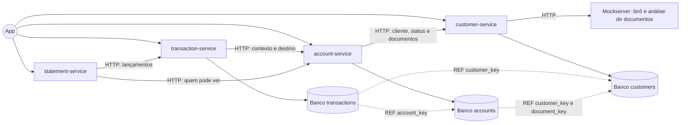

Seta cheia: chamada HTTP, ou o serviço acessando o próprio banco. Seta tracejada: um banco guarda a key de um registro de outro banco, sem chave estrangeira. O statement-service não tem banco: ele só lê, pelos outros serviços.

#### Banco do customer-service

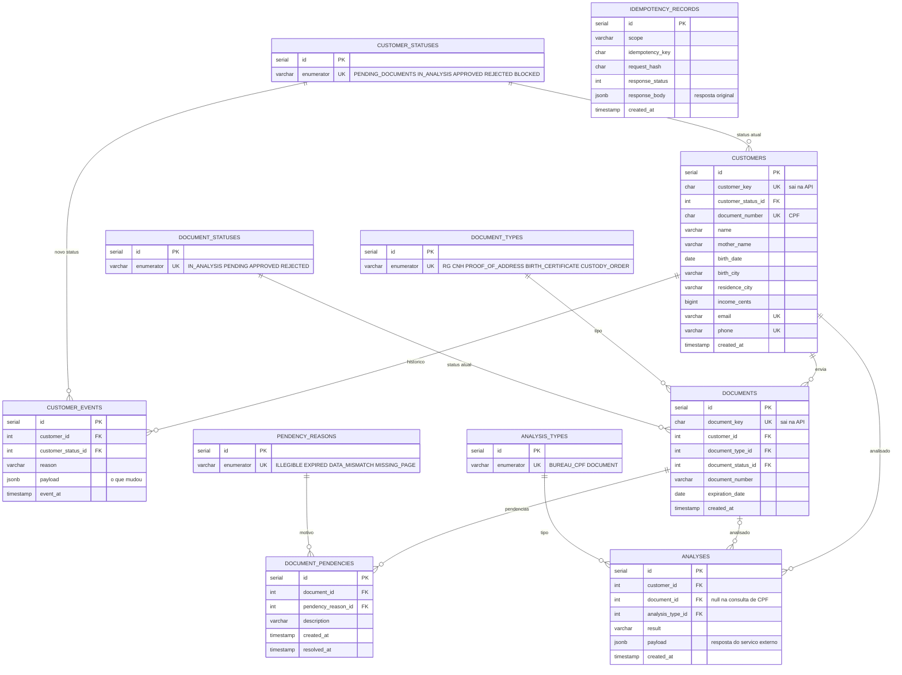

#### Banco do account-service

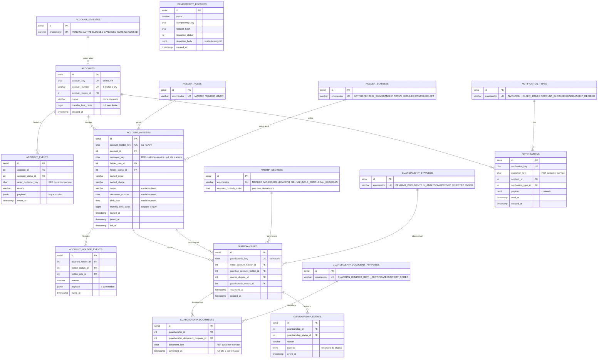

#### Banco do transaction-service

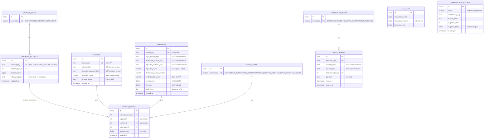

#### Restrições que o diagrama não mostra

| Banco | Restrição | O que garante |
| --- | --- | --- |
| Todos | `UNIQUE(scope, idempotency_key)` em `idempotency_records` | A mesma criação não grava duas vezes |
| account | Índice único parcial em `account_holders(customer_key)` para `INVITED`, `PENDING_GUARDIANSHIP` e `ACTIVE` | Uma conta por pessoa, mantendo quem saiu no histórico |
| account | Índices únicos parciais em `invited_email` e `invited_phone` para convites ainda sem `customer_key` | Um convite pendente por contato |
| account | Índice único parcial em `guardianships(minor_account_holder_id)` para `APPROVED` | Um responsável aprovado por menor |
| transaction | `CHECK (allows_negative OR balance_cents >= 0)` | Saldo de cliente nunca negativo; só a conta de liquidação pode ficar negativa, porque representa o dinheiro que entrou de fora |
| transaction | `CHECK (origin_account_key <> destination_account_key)` | Ninguém transfere para a própria conta |
| transaction | `CHECK (amount_cents >= 1000)` em depósitos e transferências | Mínimo de R$ 10,00 |
| transaction | `CHECK` de exatamente um entre `deposit_id` e `transfer_id` | Todo lançamento pertence a uma operação, e só a uma |
| transaction | Índice em `ledger_entries(account_balance_id, created_at)` | Extrato e limite mensal do menor rápidos |

#### Fluxos de dados por API

Para cada API: o que cada ação grava (cada seta diz a operação: `INSERT` cria uma linha, `UPDATE` altera) e como os status mudam. Elipses são ações; cilindros são tabelas.

**1. customer-service**

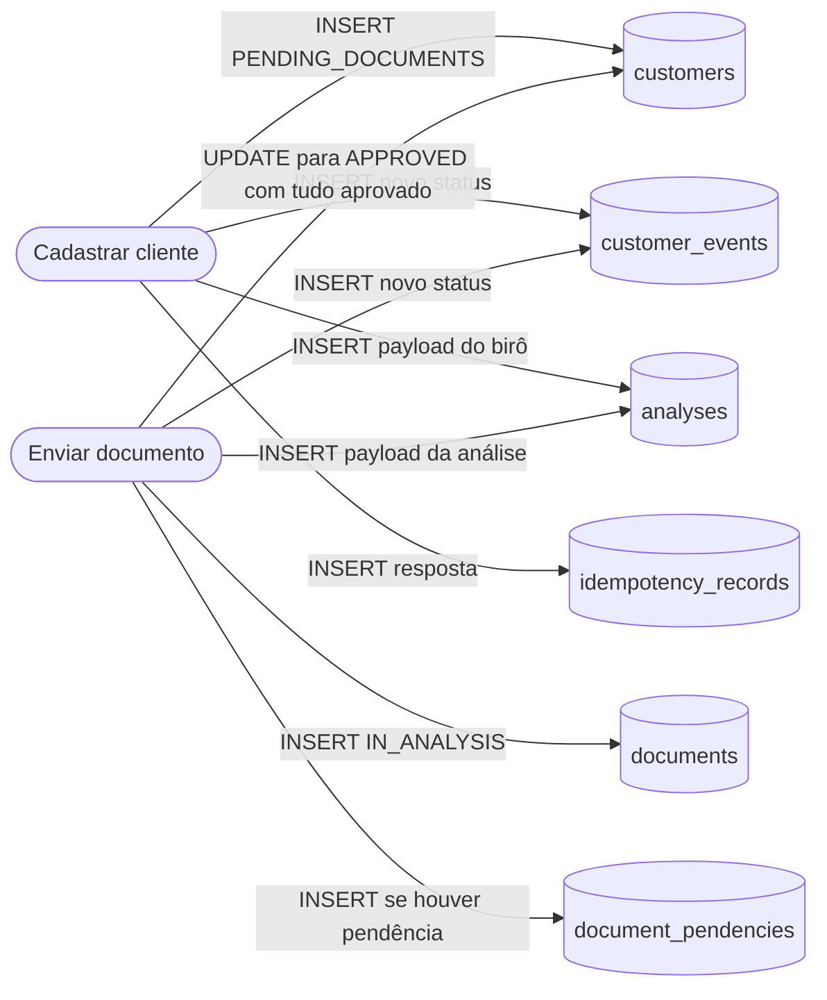

Status do cliente:

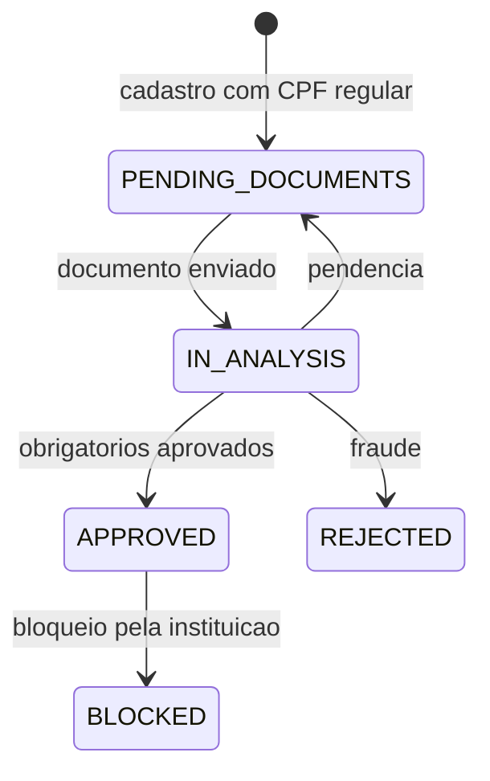

Status do documento:

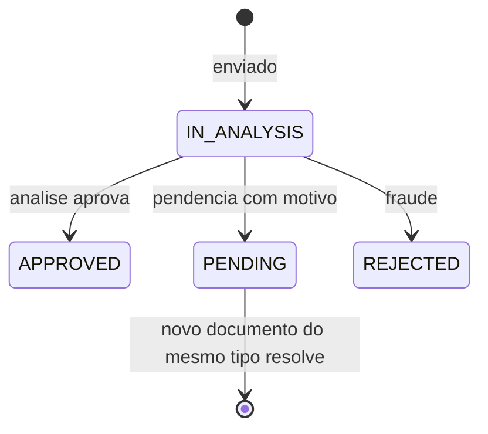

**2. account-service**

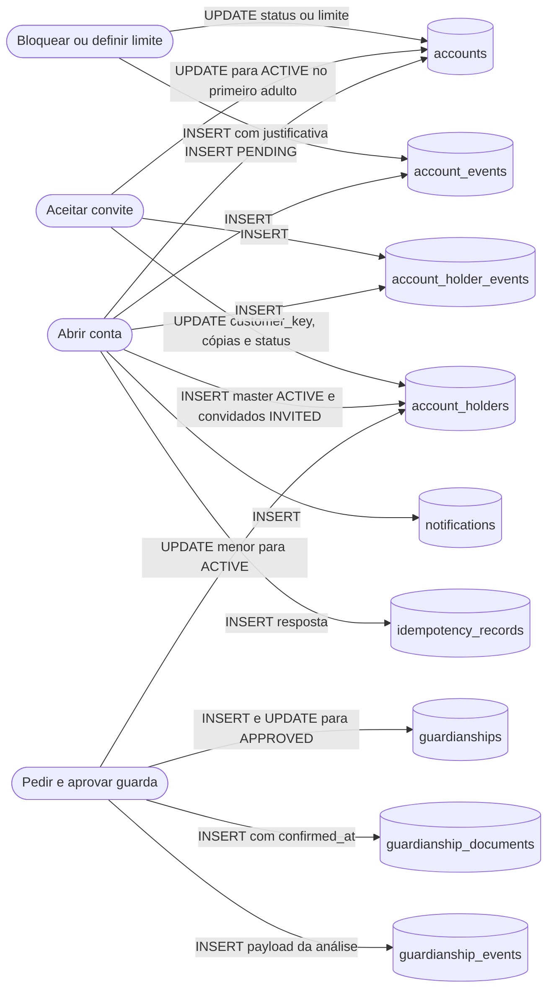

Status da conta:

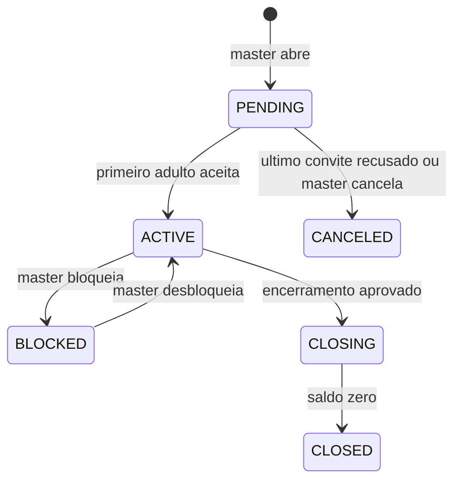

Status do titular:

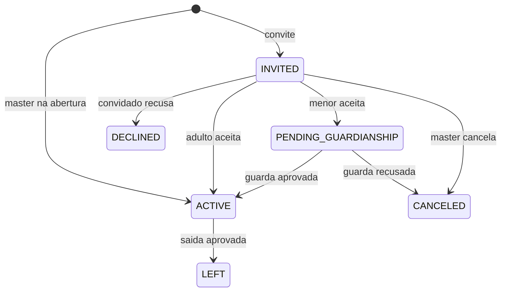

Status da guarda:

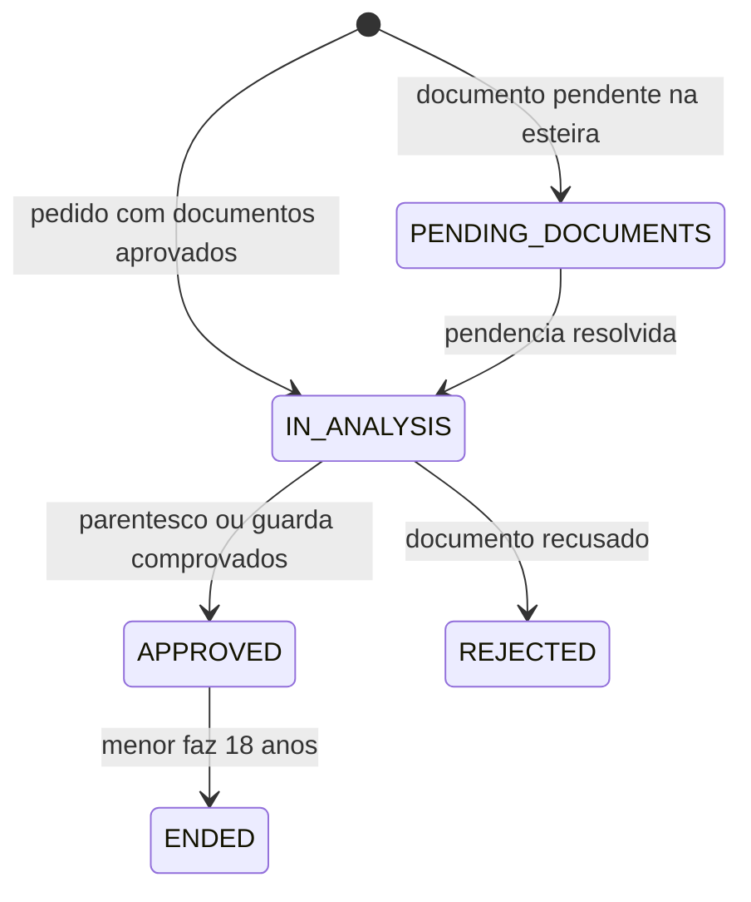

**3. transaction-service**

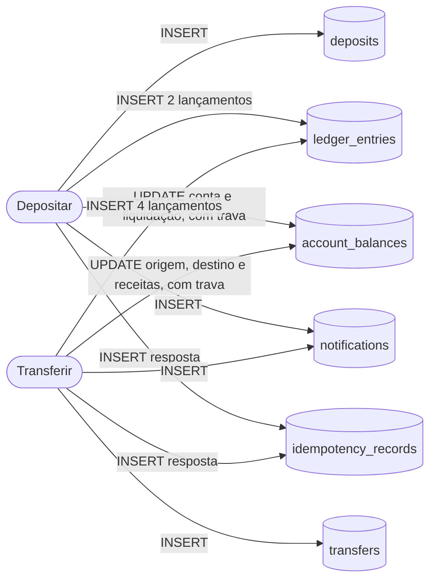

As operações de dinheiro não têm status: são imediatas, então ou aconteceram (e estão no ledger) ou não aconteceram (e nada foi gravado). O que muda, na prática, com dois exemplos:

**Depósito de R$ 500,00 da Ana na conta do apartamento**

| Tabela | Linha | Antes | Depois |
| --- | --- | --- | --- |
| `account_balances` | Conta do apartamento | 150000 | 200000 |
| `account_balances` | Conta de liquidação | −900000 | −950000 |
| `deposits` | Nova linha | — | `deposit_key`, Ana, 50000 |
| `ledger_entries` | Dois lançamentos | — | `SETTLEMENT_DEBIT` −50000 na liquidação; `DEPOSIT_CREDIT` +50000 no apartamento |
| `notifications` | Uma por titular | — | "Ana depositou R$ 500,00" |
| `idempotency_records` | Nova linha | — | A resposta 201 do depósito |

Soma dos lançamentos da operação: −50000 + 50000 = **0**.

**Transferência de R$ 2.000,00 do apartamento (4 adultos) para a conta da família**

| Tabela | Linha | Antes | Depois |
| --- | --- | --- | --- |
| `account_balances` | Apartamento (origem) | 250000 | 49000 |
| `account_balances` | Família (destino) | 30000 | 230000 |
| `account_balances` | Receitas da instituição | 120000 | 121000 |
| `transfers` | Nova linha | — | `transfer_key`, 200000, tarifa 1000, 4 adultos |
| `ledger_entries` | Quatro lançamentos | — | `TRANSFER_DEBIT` −200000 e `FEE_DEBIT` −1000 na origem; `TRANSFER_CREDIT` +200000 no destino; `FEE_CREDIT` +1000 nas receitas |
| `notifications` | Titulares das duas contas | — | Saída e entrada |
| `idempotency_records` | Nova linha | — | A resposta 201 da transferência |

Soma dos lançamentos da operação: −200000 − 1000 + 200000 + 1000 = **0**.

**4. statement-service**

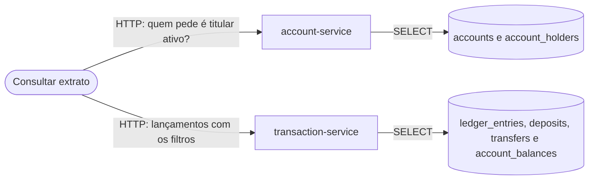

O statement-service não grava nada e não tem banco próprio. Isso é uma escolha: um banco do extrato seria uma segunda cópia dos lançamentos, que poderia divergir do ledger. Lendo sempre da fonte, o extrato bate com o saldo por construção.

> **Principal desafio do modelo**
>
> **Qual é:** garantir que cada pessoa esteja em uma conta só, com convites que podem ser feitos a quem ainda não é cliente, e que um menor só entre com um responsável legítimo.
>
> **Por que é difícil:** dois grupos podem convidar a mesma pessoa ao mesmo tempo, e as duas requisições conferem antes que qualquer uma grave. Quem ainda não é cliente só pode ser identificado pelo contato. Um `UNIQUE` simples não serve, porque quem saiu de uma conta continua registrado (R4). E "responsável" não é um papel que alguém declara: é uma relação entre duas pessoas que precisa de prova.
>
> **Como o desenho resolve:** três índices únicos parciais em `account_holders` (pela pessoa, pelo e-mail e pelo celular), que fazem o banco recusar o segundo convite ou o segundo aceite. A guarda é uma tabela própria, `guardianships`, com grau de parentesco e documentos confirmados; o grau diz se a certidão basta (pais) ou se o documento de guarda é obrigatório (avós e outros). O menor fica em `PENDING_GUARDIANSHIP` até a guarda ser aprovada.

### Fluxos

#### Cadastrar cliente — caminho feliz

1. Procura a `Idempotency-Key` em `idempotency_records`; se já existe, devolve a resposta guardada.
2. O schema valida o corpo, incluindo a máscara do CPF.
3. O controller confere os dígitos do CPF e a idade mínima de 15 anos, sem consultar o banco.
4. Procura CPF, e-mail e telefone em `customers`. Nenhum existe.
5. Chama o birô (Mockserver), com timeout. Ele confirma que o CPF existe, está regular e bate com nome e nascimento; a resposta completa vai para `analyses`, no `payload`.
6. Grava o cliente como `PENDING_DOCUMENTS`, o evento em `customer_events` e a resposta em `idempotency_records`, confirma e responde 201 com a `customer_key`. Dois cadastros do mesmo CPF ao mesmo tempo esbarram no `UNIQUE`, e o segundo recebe 409.

#### Cadastrar cliente — falha: o birô não ajuda

1. Duplicidade é conferida antes, no passo 3: um CPF já cadastrado sai com 409, sem chamar o birô.
2. O birô responde que o CPF não existe, está irregular ou não bate: 422 com o código de cada caso.
3. O birô não responde, estoura o tempo ou devolve algo inesperado: 502 QIT002009. Nos três casos nada é gravado.

#### Abrir conta — caminho feliz

1. Confere o master no customer-service: existe, tem 18 anos ou mais; e, no próprio banco, que ele não tem conta nem convite pendente.
2. Para cada convidado, pergunta ao customer-service se o e-mail ou celular pertence a um cliente. Se pertence, confere que ele não tem conta nem convite (senão, 409 QIT002022). Se não pertence, confere que o contato não tem outro convite pendente (senão, 409 QIT002032). Recusa convite ao próprio master ou repetido.
3. Gera um número de conta aleatório de 8 dígitos mais o dígito verificador.
4. Grava a conta `PENDING`, o vínculo do master `ACTIVE`, um vínculo `INVITED` por convidado (com a `customer_key`, se já é cliente, e o contato), os eventos e uma notificação no app para cada convidado que já é cliente.
5. Confirma e responde 201 com `account_key` e `account_number`.

#### Abrir conta — falha: dois grupos convidam a mesma pessoa ao mesmo tempo

1. Dois grupos convidam, ao mesmo tempo, a mesma pessoa (pela `customer_key`, se ela já é cliente) ou o mesmo contato (se ainda não é).
2. As duas requisições conferem no passo 2 e não encontram convite.
3. A primeira grava o vínculo `INVITED` e confirma.
4. A segunda esbarra no índice único parcial (da pessoa ou do contato); a transação é desfeita inteira, e a resposta é 409 QIT002022 ou QIT002032.

#### Aceitar ou recusar convite

1. Pergunta ao customer-service o status, os contatos e os dados de quem pede. O convite é dessa pessoa se a `customer_key` bate ou se o contato do convite é um dos contatos atuais dela; senão, 404 QIT002030. Se a pessoa ainda não é `APPROVED`, 422 QIT002033.
2. Confere que o convite está `INVITED`; senão, 409 QIT002031.
3. Aceite: trava a linha da conta, liga o vínculo à `customer_key`, copia nome, CPF e nascimento e cancela os outros convites pendentes da pessoa. Se ela já está em outra conta, o índice único barra, e a resposta é 409 QIT002022.
4. Adulto: papel `MEMBER`, vínculo `ACTIVE`; se a conta está `PENDING`, vira `ACTIVE`. Menor: papel `MINOR`, vínculo `PENDING_GUARDIANSHIP`; ele só fica ativo quando a guarda for aprovada.
5. Recusa: o vínculo vira `DECLINED`. Se a conta está `PENDING` e não sobrou convite pendente, a conta vira `CANCELED` na mesma transação, e o master fica livre.
6. Grava os eventos (com o payload da mudança) e as notificações dos titulares, confirma e responde 200.

#### Esteira de análise documental — caminho feliz

1. O cliente envia um documento: tipo, número e validade. O schema valida o formato; documento vencido sai com 422 QIT002012 antes da análise.
2. Grava o documento como `IN_ANALYSIS` e chama o serviço de análise (Mockserver), com timeout.
3. O serviço aprova: o documento vira `APPROVED`, e a resposta completa vai para `analyses`, no `payload`.
4. Se todos os documentos obrigatórios estão aprovados (um documento de identidade, RG ou CNH, e um comprovante de residência), o cliente vira `APPROVED`, com um evento em `customer_events`.
5. Confirma e responde 201 com a `document_key` e o status.

#### Esteira de análise documental — falha: pendência ou fraude

1. O serviço de análise aponta uma pendência: documento ilegível, vencido, com dados divergentes ou com página faltando.
2. O documento vira `PENDING`, o motivo vai para `document_pendencies`, e o cliente continua `PENDING_DOCUMENTS`; a resposta mostra o motivo.
3. O cliente envia um novo documento do mesmo tipo. Quando ele é aprovado, a pendência ganha `resolved_at`.
4. Se a análise aponta fraude (documento adulterado, foto de outra pessoa), o documento e o cliente viram `REJECTED`, com o motivo no evento. Cliente rejeitado não abre conta nem aceita convite.
5. Se o serviço de análise não responde, 502 QIT002013, e nada é gravado.

#### Avaliação de responsabilidade — caminho feliz: mãe ou pai

1. O menor aceitou o convite e está `PENDING_GUARDIANSHIP`. Um adulto ativo da conta pede a guarda, informando o grau de parentesco (mãe) e as keys dos documentos: o RG dele e a certidão de nascimento do menor, já aprovados na esteira.
2. O account-service pergunta ao customer-service cada documento: existe, está `APPROVED`, é do tipo certo e pertence à pessoa certa (o RG ao responsável, a certidão ao menor).
3. Confere a coerência dos dados: para mãe, o nome da mãe no cadastro do menor precisa ser o nome do responsável.
4. O grau `MOTHER` não exige documento de guarda (`requires_custody_order = false`), então a certidão basta.
5. Grava os documentos com `confirmed_at`, a guarda como `APPROVED` e o evento com o resultado; o vínculo do menor vira `ACTIVE`, com papel `MINOR`, e os titulares são notificados.

#### Avaliação de responsabilidade — avós ou outro responsável com a guarda

1. A avó pede a guarda com o grau `GRANDPARENT`, que exige o documento de guarda (`requires_custody_order = true`). Sem ele, 422 QIT002036, e nada é gravado.
2. Com o RG dela, a certidão do menor e o documento de guarda aprovados na esteira, o account-service confere que o documento de guarda está em nome dela e do menor.
3. Se algum documento ainda está pendente na esteira, a guarda fica `PENDING_DOCUMENTS`, e o menor continua sem movimentar até a pendência ser resolvida.
4. Se a análise recusa o documento de guarda, a guarda vira `REJECTED`, o convite do menor é cancelado e o evento guarda o motivo.
5. Aprovada, segue como no caso dos pais. Enquanto a guarda está aprovada, o responsável não pode sair da conta. Aos 18 anos, a guarda vira `ENDED` e o papel do menor passa a `MEMBER`, com eventos dos dois lados.

#### Depositar — caminho feliz

1. Pede ao account-service o contexto da conta e confere que quem pede é titular ativo e que a conta está ativa, bloqueada ou em encerramento; sem resposta, 503 QIT002090.
2. No transaction-service, trava a linha de saldo da conta (criada no primeiro depósito), grava o depósito, o débito na conta de liquidação e o crédito na conta, soma o valor ao saldo, grava as notificações, confirma e responde 201.

#### Transferir — caminho feliz

1. Fora de qualquer transação: valida o corpo e a chave; procura a chave em `idempotency_records` (se houver, devolve o 201 original; com corpo diferente, 422 QIT002047).
2. Pede ao account-service o contexto da origem: se quem pede é titular ativo (senão, 404 QIT002020), se a conta está `ACTIVE` (senão, 409 QIT002026), quantos adultos estão ativos, se quem pede é menor e os limites. Se o account-service não responder no tempo, 503 QIT002090, e nada foi gravado.
3. Confere o dígito verificador do número de destino, sem consultar ninguém.
4. Pede ao account-service a conta de destino pelo número e pelo CPF, conferido contra a cópia do CPF guardada no vínculo: qualquer falha é a mesma 404 QIT002041. Confere que o destino recebe e que não é a própria origem.
5. Abre a transação local, cria as linhas de saldo que ainda não existem e trava os três saldos (origem, destino e receitas) com `SELECT … FOR UPDATE`, em ordem crescente de `id`. Nenhuma trava existe durante as chamadas HTTP dos passos 2 e 4.
6. Calcula a tarifa com os adultos ativos do contexto.
7. Confere o limite por transferência e, se quem pede é menor, o limite mensal: soma, no próprio banco, as transferências dele no mês do calendário (valor + tarifa, horário de São Paulo, sem estornadas) mais o valor e a tarifa desta.
8. Confere que o saldo cobre valor + tarifa.
9. Grava a transferência (com a chave, a tarifa, os adultos contados e os nomes copiados para o extrato), os quatro lançamentos, os três saldos, as notificações dos titulares das duas contas e a resposta em `idempotency_records`.
10. Confirma, o que libera as travas, e responde 201 com `transfer_key`, valor, tarifa e total.

Se a conta for bloqueada, um limite mudar ou um convite for aceito entre o passo 2 e o commit, a transferência vale para o estado lido no passo 2; a mudança passa a valer na próxima operação.

#### Transferir — falha: dois titulares disputam o mesmo saldo

1. A conta tem R$ 100,00. A Ana e o Bruno pedem R$ 80,00 cada, ao mesmo tempo.
2. A requisição da Ana trava o saldo da conta no transaction-service; a do Bruno fica parada no banco, esperando a trava.
3. A da Ana confere o saldo, grava e confirma: o saldo vai a R$ 19,50 (R$ 80,00 + R$ 0,50 de tarifa).
4. A do Bruno recebe a trava, lê R$ 19,50, não cobre R$ 80,50 e responde 422 QIT002046. Nada é gravado.

#### Transferir — falha: a mesma chave chega duas vezes ao mesmo tempo

1. O app não recebeu a resposta e repetiu o pedido com a mesma chave. As duas passam pelo passo 1 sem encontrar a chave.
2. A primeira trava, grava e confirma. A segunda espera a trava, grava e esbarra no `UNIQUE` da chave.
3. O rollback desfaz o débito duplicado; o controller captura esse erro e devolve o 201 da primeira, em vez de 500.

#### Consultar o extrato

1. Confere que quem pede é titular ativo; senão, 404 QIT002020 (R8). Não trava nada.
2. Lê os lançamentos da conta, agrupados por operação, do mais recente ao mais antigo, com os filtros pedidos.
3. Monta o resumo: o saldo atual da conta inteira e os totais de entrada, saída e tarifa dos filtros aplicados.
4. Responde 200 com `summary`, `data`, `limit`, `page` e `is_last_page`. Transferência recusada não aparece: o extrato só registra o que aconteceu.

> **Principal desafio**
>
> **Qual é:** fazer uma transferência correta (saldo nunca negativo, sem débito duplo, tarifa certa) com os dados espalhados por três bancos, sem travar a conta enquanto um serviço espera outro.
>
> **Por que é difícil:** com bancos separados, não existe uma transação nem uma trava que cubra os três serviços. Travar o saldo enquanto espera o account-service responder pararia a conta inteira. E o app, sem resposta, repete o pedido, que pode chegar enquanto o primeiro ainda está em andamento.
>
> **Como o desenho resolve:** todo dado de dinheiro mora num só banco, o do transaction-service; por isso saldo, lançamentos e chave de idempotência são gravados numa única transação local, com os três saldos (origem, destino e receitas) travados por `SELECT … FOR UPDATE` em ordem crescente de `id`, `CHECK (balance_cents >= 0)` como última defesa e `UNIQUE(scope, idempotency_key)` contra a repetição. Os dados de conta são lidos por HTTP antes de qualquer trava, então a trava dura só a gravação. Nome, CPF e nascimento dos titulares são copiados no aceite e nunca mudam, então a cópia nunca fica errada. Se um serviço cai, a resposta é 503 e o app repete com a mesma chave, sem risco de débito duplo. O que pode mudar entre a leitura e o commit (bloqueio, limite, convite aceito) é aceito como uma janela curta: vale o estado lido no início da operação.

### Testes

**O sistema é construído por TDD: só existe código que algum teste pediu.** Para cada funcionalidade, a lista de casos vem antes do código, e essa lista é esta RFC: cada regra que o sistema barra (cada linha de erro na tabela de rotas, cada caminho de falha nos fluxos) vira pelo menos um teste. O ciclo roda um caso por vez: planejar o comportamento, escrever o teste, vê-lo falhar pelo motivo certo, implementar até ficar verde e refatorar. Ver o vermelho certo prova que o teste enxerga a parte que falta; depois de verde, ele roda a cada mudança e fica vermelho no dia em que alguém quebrar a regra.

**Os testes são de integração, em caixa-preta.** Eles falam com a API só por HTTP, como o app faria, e conferem apenas status, código de erro e corpo da resposta; nenhum arquivo de teste importa código de `src/` (R1). Cada teste monta o mundo pela porta da frente (cadastra clientes, abre a conta, aceita convites, deposita), age com uma requisição e confere a resposta: prepara, age, confere. O `conftest.py` guarda o que todo teste precisa: as URLs dos quatro serviços, o `INTERNAL-TOKEN` e funções que criam clientes e contas prontas. O birô de crédito é simulado pelo Mockserver: cada teste ensina o que ele responde (expectation) e, quando importa, pergunta se a API o chamou e quantas vezes (verify). Por serem caixa-preta, os testes sobrevivem a uma refatoração que reescreva tudo por dentro.

A banca roda exatamente o que o time roda, numa máquina Linux limpa: `git clone`, `docker compose up -d` e `pytest -v` (R2). Antes da entrega, o time apaga a pasta, clona de novo e sobe do zero.

Antes da suíte começar, o `conftest.py` espera os quatro serviços e o Mockserver responderem ao `/health_check`. Cada serviço tem os testes das próprias rotas, e os testes que cruzam serviços (abrir a conta no account-service e transferir no transaction-service) provam que o ecossistema funciona junto.

| Regra desta RFC | O teste faz | E confere |
| --- | --- | --- |
| CPF válido e único | Cadastra com dígitos errados; depois cadastra o mesmo CPF duas vezes | 422 QIT002001; o segundo cadastro recebe 409 QIT002003 |
| Birô fora do ar | Ensina o Mockserver a não responder e cadastra | 502 QIT002009 e nenhum cliente criado |
| Uma conta por pessoa | Dois grupos convidam a mesma pessoa | O segundo recebe 409 QIT002022 |
| Seis vagas | Convida a sétima pessoa | 409 QIT002025 |
| Recusa cancela conta pendente | O único convidado recusa | A conta passa a `CANCELED` e o master pode abrir outra |
| Conta só com titular (R8) | Consulta a conta com um cliente que não é titular | 404 QIT002020, igual a uma conta inexistente |
| Transferência sem saldo | Transfere mais do que o saldo | 422 QIT002046 e os dois saldos iguais a antes |
| Tarifa na transferência | Transfere e consulta as duas contas e a instituição | Valor e tarifa saem da origem; o valor entra no destino; a tarifa entra na instituição; a soma é zero |
| Menor não aumenta a tarifa | Transfere numa conta com e sem menor | A mesma tarifa nas duas |
| Limite mensal do menor | O menor faz transferências até passar do limite | A que estoura recebe 422 QIT002045, contando valor + tarifa |
| Destino não revela titulares | Transfere com número inexistente e com CPF de quem não é titular | As duas respostas são idênticas: 404 QIT002041 |
| Idempotência | Repete a transferência com a mesma chave | O mesmo `transfer_key` e um único débito |
| Concorrência | Dispara transferências simultâneas que juntas passam do saldo | Nenhuma resposta 500 e saldo nunca negativo |
| Bloqueio | Bloqueia a conta e tenta enviar e receber | Envio recebe 409 QIT002026; o recebimento passa |
| Extrato paginado | Cria N operações e pede `?limit=&page=` | `data`, `limit`, `page` e `is_last_page`, da mais recente à mais antiga |
| Extrato é livro de registros | Soma os itens do extrato e tenta uma transferência recusada | A soma é igual ao saldo; a recusada não aparece |
| Operação de outra conta (R8) | Pede o detalhe de uma transação de outra conta | 404 QIT002050 |

Limite conhecido: a virada do mês do limite do menor não é testada, porque um teste de caixa-preta não controla o relógio da API e a R1 impede importar a função que calcula o início do mês.

### Próximos passos (desenhados, não implementados nesta entrega)

O núcleo entregue cobre cliente, conta, depósito, transferência com tarifa, limites, bloqueio e extrato. Os itens abaixo já têm regras decididas pelo time e entram como tabelas e rotas novas, sem mudar o que existe.

#### Pagamento de boleto

- Segue o modelo de integração da aula de 03/10, pelo connector de boletos já presente no base-service, simulado no Mockserver.
- Como depende de um serviço externo, o valor é reservado numa transação, o serviço é chamado sem nenhuma linha travada, e uma segunda transação confirma ou devolve a reserva.
- Boleto vencido, já pago ou inexistente tem código de erro próprio; o serviço fora do ar responde 502.

#### Estorno

- É uma devolução feita por qualquer titular da conta que recebeu a transferência.
- Sempre total e uma vez só por transferência; devolve o valor e a tarifa (que sai da conta da instituição).
- Entra como um registro novo, com os quatro lançamentos invertidos; a transferência original não muda. Precisa de saldo na conta que devolve.
- Uma transferência estornada deixa de contar no limite mensal do menor.

#### Divisão de despesas

- Qualquer titular cria uma despesa: descrição, valor total, os titulares que participam (inclusive menores) e a parte de cada um, em valores livres.
- A soma das partes precisa ser igual ao total; senão, 422.
- É só uma atribuição e um aviso: não trava dinheiro nem impede transferências. Cada participante recebe uma notificação no app, com um atalho para depositar a sua parte.
- Não entra no extrato; só o depósito que a pessoa fizer entra. Rota prevista: `POST /account/{account_key}/expense`, com as tabelas de despesa e de partes.

#### Empréstimo

- O devedor é a conta, e o pedido só vale com a aprovação de todos os titulares.
- O dinheiro sai da conta da instituição; a remuneração informada no cadastro define quanto pode ser pedido.
- Juros e parcelas seguem o padrão dos bancos digitais e variam levemente com o número de titulares.
- Em atraso, há multa e juros de mora. O Código de Defesa do Consumidor limita a multa a 2% da prestação; o valor final ainda será definido dentro desse limite.
- Uma dívida em aberto impede a saída do titular e o encerramento da conta.

#### Encerramento da conta

- Só o master inicia. Todos os titulares precisam aprovar, inclusive o menor, em até 90 dias.
- Uma recusa cancela o pedido, e o master precisa fazer um novo. Quem não quiser continuar na conta pode sair.
- Dívida em aberto impede o encerramento.
- Aprovado, a conta vai para `CLOSING` e tem 60 dias para zerar o saldo. Ela só passa a `CLOSED` com saldo zero; o banco nunca fica com o dinheiro dos titulares.

#### Saída de titulares

- O titular pede para sair com uma explicação, e os demais titulares aprovam. O master também pode pedir a remoção de alguém, com a mesma aprovação geral. O master não sai.
- Quem pediu para sair só transfere com o aceite do master, e precisa quitar as dívidas vinculadas a ele.
- Em caso de falecimento ou saída forçada, a conta fica sob aviso por 90 dias antes da saída.
- Antes de sair, o titular pode baixar o extrato.

#### Outros

- Alteração de e-mail e telefone com código de confirmação no app; o valor antigo fica no histórico (R4).
- Bloqueio pela instituição, por inconsistência de dados ou suspeita de má-fé, por uma rota interna com o motivo registrado.
- Download do extrato, a partir das mesmas páginas da consulta.

## Alternativas consideradas e descartadas

- **Saga com reserva de saldo e compensação entre serviços** — descartada porque todo dado de dinheiro já mora num banco só; a saga só seria necessária com o saldo espalhado. Ganharia quando entrarem operações com sistema externo, como o boleto.
- **Réplica dos dados de conta no transaction-service, alimentada por eventos** — descartada porque exige fila de mensagens e um worker para manter a cópia. Ganharia com volume alto, em que a chamada HTTP por transferência pesaria.
- **Isolamento `SERIALIZABLE` em vez da trava de linha** — descartado porque obriga o app a tratar falhas de serialização com novas tentativas. Ganharia com muitas regras cruzando linhas diferentes, difíceis de travar uma a uma.
- **Abertura em pedido único, sem convite** — descartada porque coloca a pessoa numa conta sem consentimento e ocupa a única vaga dela. Ganharia se os titulares assinassem juntos, presencialmente.
- **Convite com prazo** — descartado porque o convidado pode instalar o app e só voltar dias depois, e o prazo exigiria um processo agendado. Ganharia se contas pendentes esquecidas virassem um problema real.
- **Dinheiro em `NUMERIC(15,2)`** — descartado porque o FastAPI converte `Decimal` em float ao montar a resposta, e o JSON de entrada já chega como float. Ganharia com muitas divisões e juros, como no empréstimo.
- **Tarifa percentual** — descartada porque exige regra de arredondamento sobre centavos. Ganharia se o degrau entre faixas levasse clientes a fracionar transferências.
- **Respostas diferentes para "conta inexistente" e "CPF não confere"** — descartadas porque permitem testar CPFs até descobrir titulares. Ganhariam com limite de tentativas por cliente.
- **Pré-consulta do destino mostrando o nome mascarado** — descartada porque revelaria nomes a qualquer pessoa com um número de conta. Ganharia em conforto para o usuário, se houvesse limite de consultas.
- **Fila no servidor para repetir transferências** — descartada porque tornaria assíncrona uma operação interna e imediata. Ganharia em operações com sistema externo.
